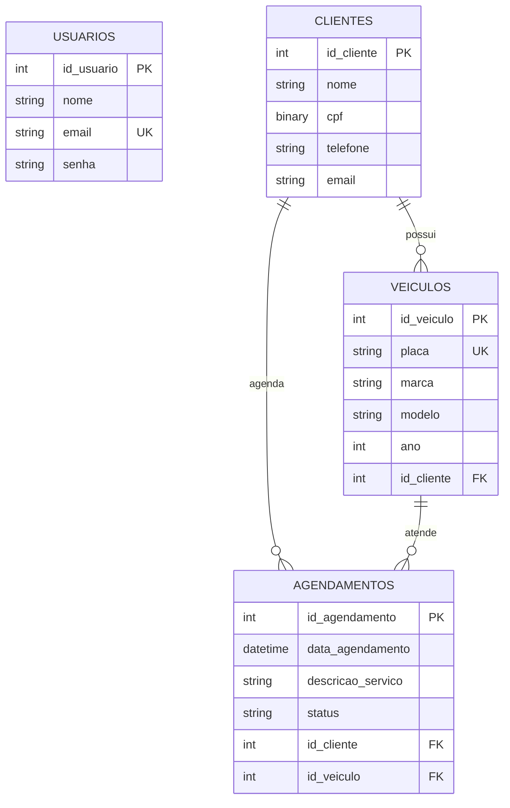

# Oficina Flux

Aplicação Laravel para gerenciar os usuários, clientes, veículos e agendamentos da oficina. O projeto usa os nomes de tabelas e colunas do banco `simulado_mecanica`.

## Banco de dados

O arquivo `.env` deve apontar para o MySQL local:

```dotenv
DB_CONNECTION=mysql
DB_HOST=127.0.0.1
DB_PORT=3306
DB_DATABASE=simulado_mecanica
DB_USERNAME=seu_usuario
DB_PASSWORD=sua_senha
SESSION_DRIVER=file
CACHE_STORE=file
QUEUE_CONNECTION=sync
```

Se as tabelas do SQL fornecido já foram criadas, **não execute `php artisan migrate`**: as migrations do projeto são para criar esse esquema em um banco vazio e entrariam em conflito com as tabelas existentes. A aplicação não precisa de tabelas extras para sessões, cache ou filas.

Instale as dependências com `composer install`, configure a `APP_KEY` com `php artisan key:generate` e inicie o servidor com `php artisan serve`. Para gerar uma senha compatível com o login, execute `php artisan tinker` e crie um usuário:

```php
App\Models\User::create([
    'nome' => 'Administrador',
    'email' => 'admin@oficina.local',
    'senha' => Illuminate\Support\Facades\Hash::make('defina-uma-senha-forte'),
]);
```

A coluna `senha` armazena hash, e o login valida a senha enviada contra esse hash. Não reutilize a senha de exemplo em produção.

Contas antigas com senha em SHA-256 hexadecimal são verificadas durante o login e atualizadas para bcrypt após a primeira autenticação bem-sucedida. A senha em texto não é armazenada.

## Requisitos implementados

- Login com validação de credenciais, sessão com expiração por inatividade e opção de sair.
- Pesquisa de clientes por nome, e-mail ou telefone e edição dos cadastros.
- Criptografia de CPF com o cast `encrypted` do Laravel e a chave `APP_KEY`.
- Cadastro de veículos associado a um cliente.
- Agenda ordenada por data e horário, exibindo os dados do cliente e do veículo. O veículo selecionado deve pertencer ao cliente selecionado.
- Edição dos dados do agendamento, incluindo data e horário.
- Validação no servidor e proteção CSRF dos formulários.

O CPF criptografado não pode ser pesquisado por comparação SQL. A pesquisa de clientes usa nome, e-mail e telefone. Mantenha a `APP_KEY` protegida e estável; sem ela, os CPFs criptografados não podem ser lidos.

## Modelo entidade-relacionamento



## Código

- `app/Models`: mapeamento das entidades para nomes de tabela e chaves personalizados.
- `app/Http/Controllers`: autenticação e operações dos módulos.
- `app/Http/Middleware/ExpireSession.php`: expiração de sessão por inatividade.
- `database/migrations`: criação do esquema descrito acima para um banco vazio.
- `resources/views`: todos os arquivos Blade ficam diretamente nesta pasta, sem subpastas.
- `routes/web.php`: rotas públicas e autenticadas.
